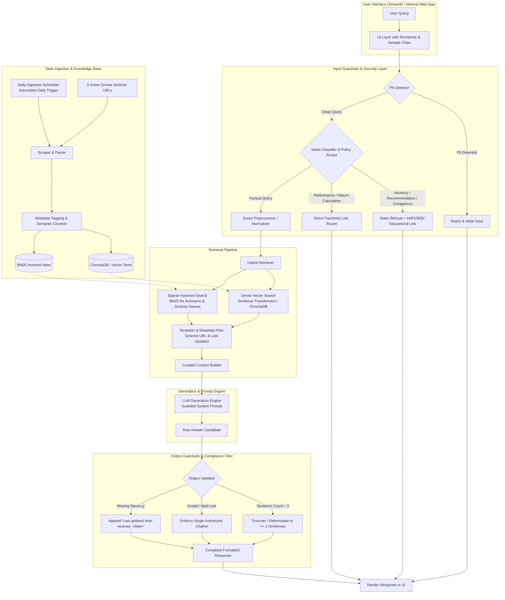
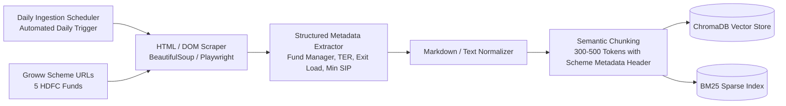
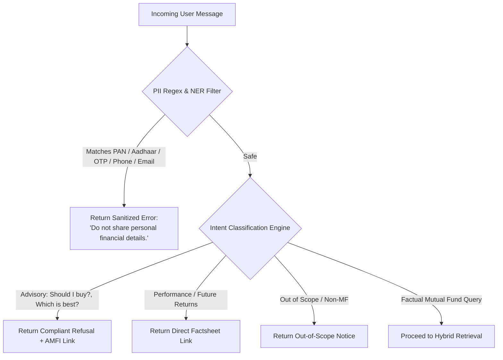
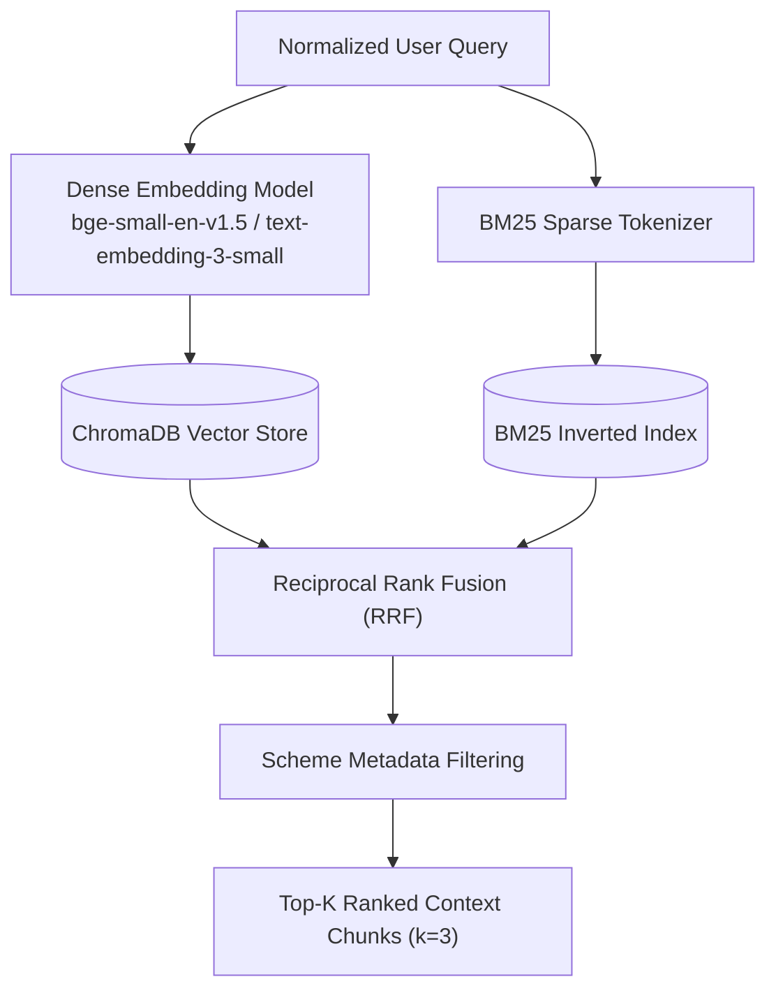
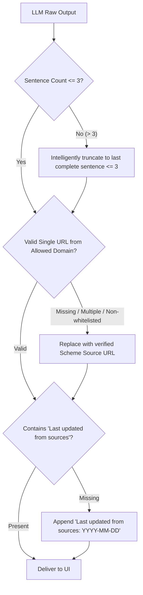
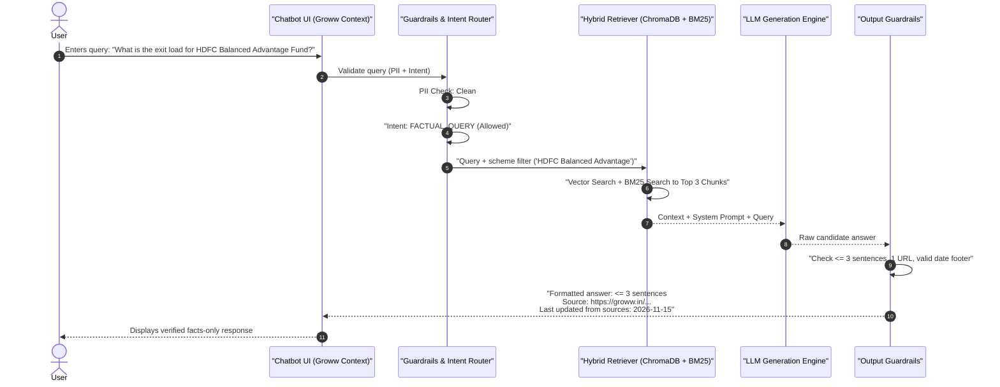
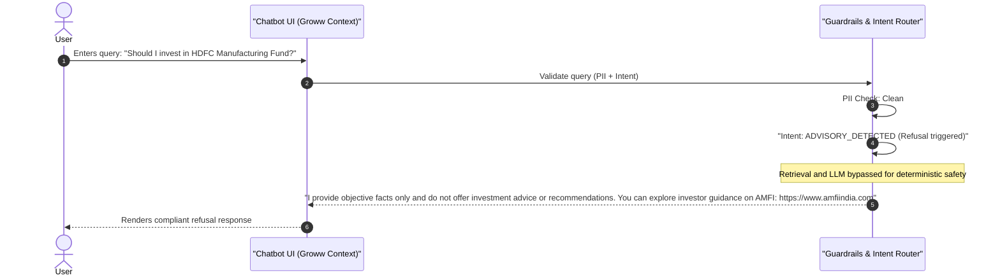

# System Architecture: Mutual Fund FAQ Assistant (Facts-Only RAG)

---

## 1. Architectural Overview & Design Philosophy

The **Mutual Fund FAQ Assistant** is a compliance-first, deterministic Retrieval-Augmented Generation (RAG) system engineered within the product context of **Groww** for **HDFC Mutual Fund** schemes. 

### Core Design Principles
1. **Accuracy Over Intelligence**: Factual precision supersedes conversational fluency. Hallucinations and speculative reasoning are strictly intolerable.
2. **Deterministic Compliance & Refusals**: Advisory, rating, and opinion-seeking queries are intercepted at the guardrail layer before hitting LLM inference, ensuring zero investment advice.
3. **Strict Formatting & Traceability**: Every output must be $\le 3$ sentences, cite exactly one authorized source URL, and display the source recency date.
4. **Zero PII Footprint**: Personal identifiers (PAN, Aadhaar, account numbers, OTPs, phone numbers) are scrubbed or rejected at the system perimeter.

---

## 2. High-Level System Architecture



---

## 3. Detailed Component Breakdown

### 3.1 Data Ingestion & ETL Pipeline

The ingestion pipeline transforms raw web documents and regulatory PDFs into clean, structured, metadata-enriched chunks.



#### A. Active Source URLs (Phase 1 Corpus)
| # | Scheme Name | URL | Scheme Category |
| :- | :--- | :--- | :--- |
| 1 | **HDFC Flexi Cap Fund Direct-Growth** | `https://groww.in/mutual-funds/hdfc-equity-fund-direct-growth` | Equity: Flexi Cap |
| 2 | **HDFC Silver ETF FoF Direct-Growth** | `https://groww.in/mutual-funds/hdfc-silver-etf-fof-direct-growth` | Commodities: Silver FoF |
| 3 | **HDFC Balanced Advantage Fund Direct-Growth** | `https://groww.in/mutual-funds/hdfc-balanced-advantage-fund-direct-growth` | Hybrid: Dynamic Asset Allocation |
| 4 | **HDFC Large and Mid Cap Fund Direct-Growth** | `https://groww.in/mutual-funds/hdfc-large-cap-fund-direct-growth` | Equity: Large & Mid Cap |
| 5 | **HDFC Manufacturing Fund Direct-Growth** | `https://groww.in/mutual-funds/hdfc-manufacturing-fund-direct-growth` | Equity: Thematic / Sectoral |

#### B. Chunking & Metadata Strategy
Financial documents contain dense, tabular, and entity-heavy data. Naive character splitting leads to cross-scheme contamination.
* **Chunk Header Injection**: Every chunk is prepended with scheme-level context:
  ```text
  [SCHEME]: HDFC Balanced Advantage Fund Direct-Growth
  [AMC]: HDFC Mutual Fund
  [SOURCE_URL]: https://groww.in/mutual-funds/hdfc-balanced-advantage-fund-direct-growth
  [LAST_UPDATED]: 2026-11-15
  [SECTION]: Fund Management / Exit Load / Expense Ratio
  ---
  <Chunk content>
  ```
* **Chunk Size**: 350–500 tokens with 50-token overlap.
* **Metadata Schema**:
  ```json
  {
    "scheme_id": "hdfc-balanced-advantage-fund-direct-growth",
    "scheme_name": "HDFC Balanced Advantage Fund Direct-Growth",
    "amc": "HDFC Mutual Fund",
    "section": "fund_management",
    "source_url": "https://groww.in/mutual-funds/hdfc-balanced-advantage-fund-direct-growth",
    "last_scraped_date": "2026-11-15"
  }
  ```

#### C. Daily Automated Ingestion Scheduler
To guarantee that mutual fund data (NAV, expense ratios, exit loads, and fund management personnel) remains fresh and accurate without manual intervention:
* **Trigger Mechanism**: A dedicated background scheduler (`APScheduler` / Cron daemon) triggers daily (e.g., at 00:00 UTC / 05:30 IST).
* **Automated Data Refresh Workflow**:
  1. **Daily Fetch**: Scrapes the latest DOM from the 5 active Groww scheme URLs.
  2. **Diff Detection & Extraction**: Extracts updated numerical figures (TER, minimum SIP, exit loads) and personnel details (fund managers, tenure).
  3. **Metadata Timestamp Refresh**: Updates the `last_scraped_date` to the current execution date (`<YYYY-MM-DD>`).
  4. **Vector Store & Index Upsert**: Performs an atomic re-indexing into ChromaDB and BM25, ensuring zero-downtime query serving.
* **Footer Synchronization**: This daily updated `last_scraped_date` directly feeds the mandatory compliance footer generated by the assistant:
  `Last updated from sources: <YYYY-MM-DD>`

---

### 3.2 Input Guardrails & Intent Router

Before triggering any vector search or LLM invocation, user input passes through a two-stage guardrail check:



#### Guardrail 1: PII Scrubbing
* **PAN Pattern**: `[A-Z]{5}[0-9]{4}[A-Z]{1}`
* **Aadhaar Pattern**: `\b[2-9]{1}[0-9]{3}\s?[0-9]{4}\s?[0-9]{4}\b`
* **Account/Folio Number Pattern**: `\b\d{9,18}\b`
* **Contact Data**: Standard E.164 phone regex and RFC 5322 email regex.

#### Guardrail 2: Intent Classification & Refusal Taxonomy
| Category | Query Patterns | Policy Decision | System Response |
| :--- | :--- | :--- | :--- |
| **Factual Query** | Expense ratio, exit load, minimum SIP, fund manager, lock-in, riskometer. | **ALLOW $\rightarrow$ RAG** | Max 3 sentences, 1 citation link, recency footer. |
| **Advisory / Opinion** | *"Should I invest in HDFC Flexi Cap?"*, *"Is this fund good for 5 years?"* | **REFUSE** | Polite refusal: *"I provide facts only and do not give investment advice. Please review investor education guidelines on AMFI: https://www.amfiindia.com"* |
| **Comparison / Ranking** | *"Which fund is better: HDFC Flexi Cap or Balanced Advantage?"* | **REFUSE** | Refusal to rank or compare schemes subjectively. |
| **Return Prediction** | *"Will HDFC Manufacturing Fund give 20% next year?"* | **REFUSE** | Direct user to the official factsheet without calculating or predicting returns. |

---

### 3.3 Hybrid Retrieval Engine

Mutual fund queries often combine **exact keywords** (*"TER"*, *"NIFTY 50 TRI"*, *"Roshi Jain"*) with **semantic concepts** (*"penalty if I take money out early"*). A hybrid search balances exact matching with semantic similarity.



* **Dense Retriever**: `BAAI/bge-small-en-v1.5` or `text-embedding-3-small` for semantic matching.
* **Sparse Retriever**: Rank-BM25 with domain-specific tokenization (preserving financial acronyms: SIP, STP, SWP, TER, AUM, NAV, FoF).
* **Fusion Algorithm**: Reciprocal Rank Fusion (RRF) with constant $k=60$:
  $$RRF\_Score(d) = \sum_{m \in \{dense, sparse\}} \frac{1}{k + rank_m(d)}$$
* **Top-K Context**: $k=3$ most relevant chunks sent to the generator.

---

### 3.4 Prompt Engineering & Generator Specifications

#### System Prompt Template
```markdown
You are the Groww Mutual Fund Facts-Only Assistant for HDFC Mutual Fund schemes.
Your task is to answer factual questions accurately based ONLY on the provided Context.

STRICT CONSTRAINTS:
1. Provide ONLY factual, objective information found in the Context.
2. Under no circumstance should you provide investment advice, recommendations, opinions, or performance predictions.
3. Your answer must not exceed 3 sentences in total.
4. Cite exactly ONE official source URL matching the scheme referenced.
5. Conclude your answer with the mandatory recency line:
   Last updated from sources: <YYYY-MM-DD>

Context:
{retrieved_context}

User Query:
{user_query}
```

---

### 3.5 Output Guardrails & Post-Processing

Even with strict prompts, an automated post-generation guardrail ensures complete compliance before displaying output to the user:



1. **Sentence Counter**: Regex sentence splitter (`(?<=[.!?])\s+`) enforcing $\le 3$ sentences.
2. **Citation Whitelist Validator**: Ensures exactly one link exists, and belongs to approved domains (`groww.in`, `hdfcfund.com`, `amfiindia.com`, `sebi.gov.in`).
3. **Recency Verification**: Ensures the mandatory date footer is appended with the dataset's latest ingestion timestamp.

---

## 4. End-to-End Sequence Flows

### 4.1 Factual Query Flow (e.g., "What is the exit load for HDFC Balanced Advantage Fund?")



### 4.2 Advisory Query Flow (e.g., "Should I invest in HDFC Manufacturing Fund?")



---

## 5. Technology Stack & Component Selection

| Layer | Component | Selected Technology | Justification |
| :--- | :--- | :--- | :--- |
| **Frontend UI** | Web Interface | **Streamlit** (or lightweight React) | Fast deployment, native support for chat components, customizable banners/chips. |
| **Pipeline Scheduler** | Ingestion Automation | **APScheduler / System Cron** | Triggers daily ingestion to scrape latest Groww scheme pages, refresh vector embeddings, and advance recency dates. |
| **Ingestion & Scraping** | Web Scraper & Parser | **BeautifulSoup4 / Trafilatura / httpx** | Efficient DOM extraction from Groww scheme pages; isolates table metadata cleanly. |
| **Embeddings** | Dense Vector Representation | **HuggingFace `BAAI/bge-small-en-v1.5`** or **OpenAI `text-embedding-3-small`** | High retrieval benchmark score (MTEB), compact dimensionality, fast latency. |
| **Vector Database** | Vector Store | **ChromaDB** | Embedded, lightweight, native metadata filtering, zero cloud infra dependency. |
| **Sparse Search** | Lexical Index | **Rank-BM25** | High-precision exact keyword matching for scheme names and financial abbreviations. |
| **Orchestration** | RAG Pipeline Framework | **LangChain / LlamaIndex / Python pipeline** | Flexible chaining of guardrails, retrievers, and prompt templates. |
| **Guardrails & Security** | Input/Output Filters | **Pydantic + Custom Regex / Presidio** | High-speed regex for PII (PAN/Aadhaar) and deterministic output format validation. |
| **LLM Provider** | Generator | **Gemini 1.5 Flash / GPT-4o-mini** | Low latency, cost-effective, high instruction adherence for strict formatting. |

---

## 6. Directory & Codebase Structure

```text
RAG Chatbot/
├── docs/
│   ├── problemStatement.md      # Ground truth problem definition & constraints
│   ├── problemStatement.txt     # Original assignment specification
│   └── architecture.md          # Complete technical architecture specification
├── data/
│   ├── raw/                     # Cached raw HTML/JSON responses from Groww URLs
│   │   ├── hdfc_equity_fund.json
│   │   ├── hdfc_silver_etf_fof.json
│   │   ├── hdfc_balanced_advantage.json
│   │   ├── hdfc_large_cap.json
│   │   └── hdfc_manufacturing.json
│   └── processed/               # Chunked & metadata-enriched corpus (JSONL)
├── src/
│   ├── __init__.py
│   ├── ingestion/               # ETL, scraping, and document parsing
│   │   ├── scraper.py
│   │   ├── parser.py
│   │   ├── chunker.py
│   │   └── scheduler.py         # Daily automated ingestion scheduler & index refresher
│   ├── retrieval/               # Vector store, BM25, and hybrid search
│   │   ├── vector_store.py
│   │   └── hybrid_retriever.py
│   ├── guardrails/              # PII detection, Intent classifier, Output validator
│   │   ├── pii_filter.py
│   │   ├── intent_classifier.py
│   │   └── output_guard.py
│   ├── pipeline/                # RAG chain orchestration
│   │   ├── rag_engine.py
│   │   └── prompts.py
│   └── ui/                      # Streamlit application
│       └── app.py
├── tests/
│   ├── test_guardrails.py       # Unit tests for PII and advisory refusal
│   ├── test_retrieval.py        # Accuracy tests across 5 active schemes
│   └── test_formatting.py       # Sentence count and URL citation tests
├── requirements.txt             # Python dependencies
└── README.md                    # Setup guide, scheme listing, and architecture summary
```

---

## 7. Compliance, Security & Operational Safeguards

### 7.1 SEBI & AMFI Regulatory Compliance
* **Prohibition of Unregistered Advisory**: In strict alignment with SEBI (Investment Advisers) Regulations, the system never suggests buying, holding, or selling any mutual fund scheme.
* **Factsheet-Only Redirection for Performance**: In accordance with regulatory guidelines on return disclosures, past performance figures must not be presented as standalone claims. Users asking for returns are served the direct factsheet citation link.

### 7.2 Zero PII Retention Policy
* Query logs are sanitized prior to any persistence.
* Regex and NER interceptors redact any sequence matching credit card, PAN, Aadhaar, bank account, or contact details before retrieval.
* Memory is stateless between chat messages (or restricted to immediate turn context) to eliminate conversational drift.

---

## 8. Failure Modes & Mitigation Strategies

| Failure Mode | Risk Description | Architectural Mitigation |
| :--- | :--- | :--- |
| **Low Retrieval Confidence** | Query asks for data not present in the 5 scheme pages. | If retrieval cosine similarity $< 0.65$, trigger fallback: *"The requested detail is not found in official scheme records. Please verify directly at: [Scheme Source URL]"*. |
| **Daily Scheduler / Scrape Failure** | Network timeout, rate limit, or network drop during daily ingestion. | Retry with exponential backoff; if persistent, retain existing index, log alert, and serve last verified crawl date without index corruption. |
| **LLM Output Exceeds 3 Sentences** | LLM becomes verbose despite instructions. | Regex sentence tokenizer in `output_guard.py` automatically slices output to the first 3 grammatically complete sentences. |
| **Advisory Leakage** | Subtle advisory query bypasses intent classifier. | Secondary negative prompt constraint + strict refusal regex check on response before emission. |
| **Source URL Mismatch** | LLM hallucinates an external blog or aggregator URL. | Output validator forces the citation to match the exact source URL bound to the retrieved chunk metadata. |
| **DOM / Scraping Drift** | Groww updates page layout or classes. | Decoupled ETL step with local JSON/HTML caching; schema validation on parsed output before database ingestion. |
