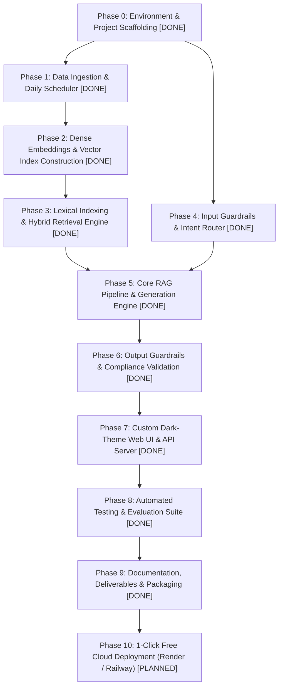

# Phase-Wise Implementation Plan: Mutual Fund FAQ Assistant

---

## 1. Executive Summary & Implementation Roadmap

This implementation plan outlines the engineering roadmap to build the **Mutual Fund FAQ Assistant (Facts-Only RAG)** in accordance with the specifications defined in [`docs/problemStatement.md`](file:///Users/gaga/Desktop/ELITE%20Projects/RAG%20Chatbot/docs/problemStatement.md) and the system architecture in [`docs/architecture.md`](file:///Users/gaga/Desktop/ELITE%20Projects/RAG%20Chatbot/docs/architecture.md).

### High-Level Milestones & Dependencies



---

## 2. All Phases Status Summary (0 Through 10)

| Phase | Description | Deliverables | Status | Tests Passed |
| :--- | :--- | :--- | :--- | :--- |
| **Phase 0** | Environment & Scaffolding | `requirements.txt`, `.gitignore`, `.env.example` | **Completed & Verified** | 4 / 4 |
| **Phase 1** | Ingestion & Daily Scheduler (10 AM IST) | `scraper.py`, `parser.py`, `chunker.py`, `scheduler.py` | **Completed & Verified** | 11 / 11 |
| **Phase 2** | Dense Vector Store | `embeddings.py`, `vector_store.py`, `indexer.py` | **Completed & Verified** | 7 / 7 |
| **Phase 3** | Lexical Index & Hybrid RRF | `bm25_indexer.py`, `hybrid_retriever.py` | **Completed & Verified** | 10 / 10 |
| **Phase 4** | Input Guardrails & Intent Router | `pii_filter.py`, `intent_classifier.py` | **Completed & Verified** | 16 / 16 |
| **Phase 5** | Core RAG Pipeline & Groq LLM | `prompts.py`, `llm_client.py`, `rag_engine.py` | **Completed & Verified** | 15 / 15 |
| **Phase 6** | Output Guardrails & Compliance | `output_guard.py` | **Completed & Verified** | 11 / 11 |
| **Phase 7** | Custom Dark-Theme Web UI & Server | `server.py`, `src/ui/static/index.html` | **Completed & Verified** | 7 / 7 |
| **Phase 8** | Evaluation Benchmark Suite | `tests/test_evaluation.py` | **Completed & Verified** | 4 / 4 |
| **Phase 9** | Documentation & Packaging | `README.md`, Verified Docs | **Completed & Verified** | — |
| **Phase 10** | 1-Click Free Cloud Deployment | `Procfile`, dynamic `$PORT` in `src/ui/server.py` | **Planned (Next)** | Pending |

**Current Test Suite Status**: **85/85 tests passing** in ~8.8s (`pytest tests/`).
Local REST API Server operational on **`http://127.0.0.1:8000`**.

---

## 3. Daily Ingestion Scheduler: 10:00 AM IST Recurring Setup

The daily data ingestion scheduler ensures that the mutual fund knowledge corpus stays updated with current NAVs, TER, exit load, and fund manager details.

* **Trigger Time**: `10:00 AM IST` daily (`Asia/Kolkata` timezone = `04:30 AM UTC`).
* **Trigger Schedule**: `CronTrigger(hour=10, minute=0, timezone="Asia/Kolkata")`.
* **Configuration Variables** (`.env` and `src/config.py`):
  * `SCHEDULER_HOUR=10`
  * `SCHEDULER_MINUTE=0`
  * `SCHEDULER_TIMEZONE=Asia/Kolkata`
* **Execution Options**:
  1. **Immediate one-shot sync**:
     ```bash
     .venv/bin/python3 -m src.ingestion.scheduler --run-now
     ```
  2. **Live crawl one-shot sync**:
     ```bash
     .venv/bin/python3 -m src.ingestion.scheduler --run-now --force
     ```
  3. **Persistent Background Daemon (10:00 AM IST)**:
     ```bash
     .venv/bin/python3 -m src.ingestion.scheduler --schedule --hour 10 --minute 0 --timezone Asia/Kolkata
     ```
  4. **System Crontab Alternative** (10:00 AM IST = 04:30 AM UTC):
     ```cron
     30 4 * * * cd "/path/to/RAG Chatbot" && .venv/bin/python3 -m src.ingestion.scheduler --run-now --force >> /tmp/mf_scheduler.log 2>&1
     ```

